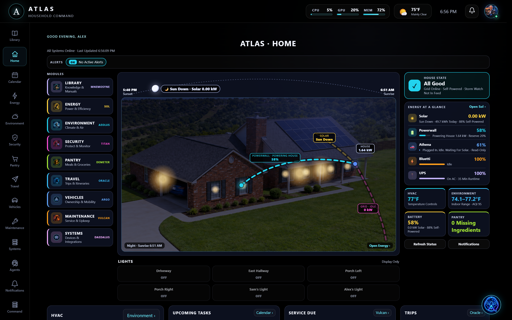
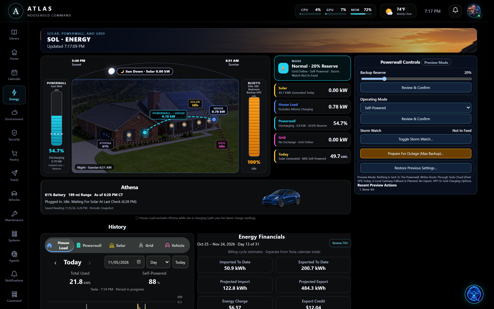
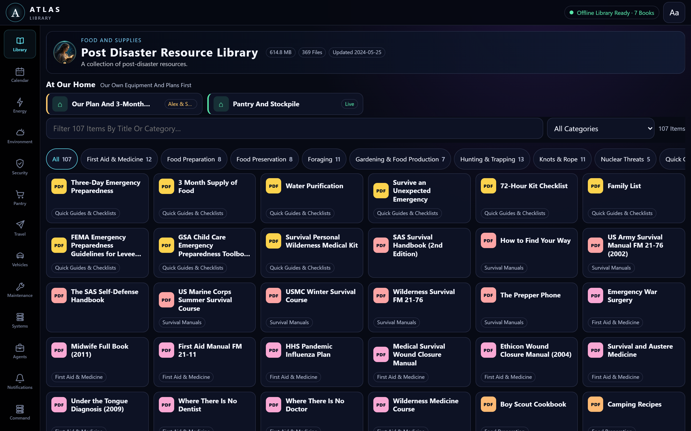
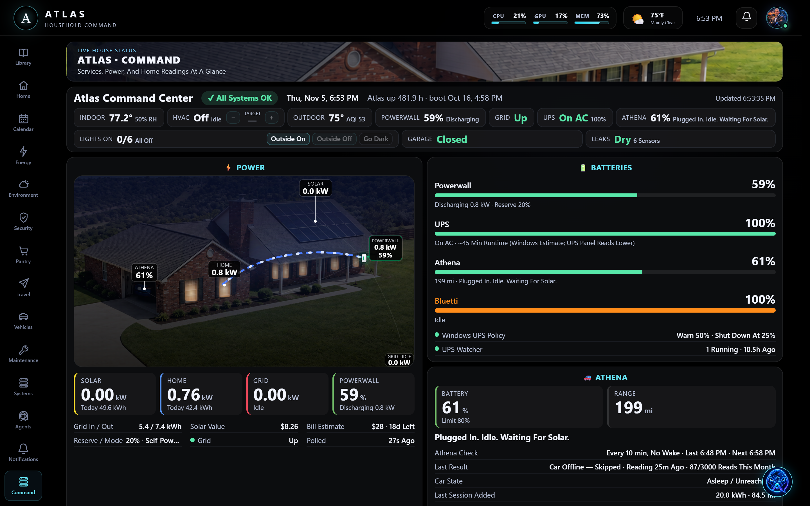
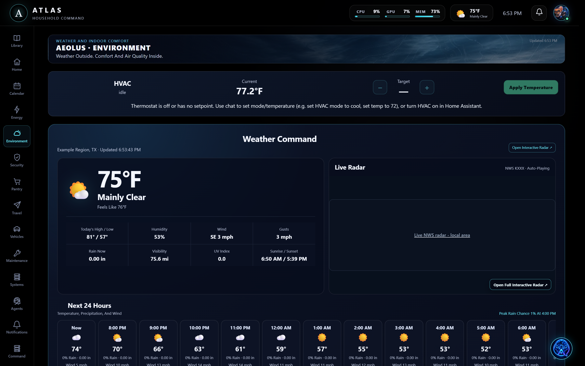
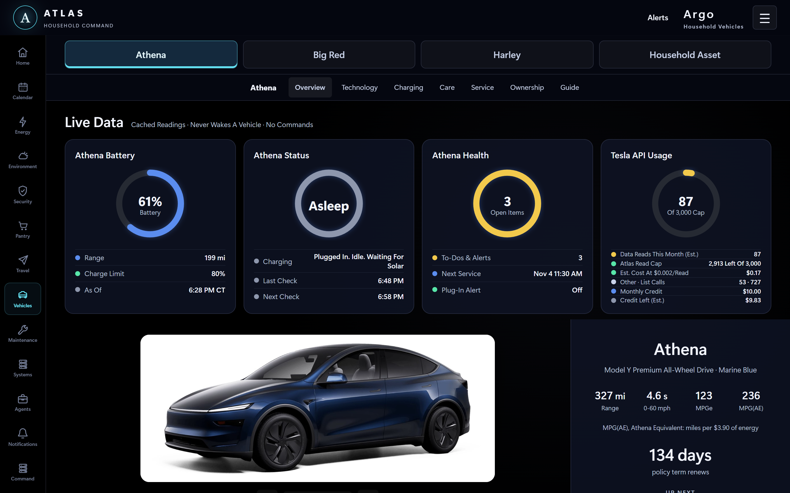

# Atlas Home Command Center

A local-first household command center for energy, home status, library reference, travel, vehicles, pantry, maintenance, and systems. Atlas runs on household hardware. Local-first does not mean every optional provider works offline: Tesla and some Home Assistant integrations still depend on their vendor clouds when configured.

This repository is a **sanitized distribution**, not a backup of a household installation. It starts without personal records or credentials. Optional integrations require your own configuration and authorization.

## Explore the current interface

| Home | Energy | Library |
|:--|:--|:--|
|  |  |  |

| Command | Environment | Vehicles |
|:--|:--|:--|
|  |  |  |

Screenshots above are from a sanitized live capture. The public energy house artwork remains the owner-approved hilltop illustration (`orchestrator/src/atlas_orchestrator/web/atlas-house-hilltop.png`). Demo and fixture records are fictional.

## November 2026 interface (current)

### Home and Command
- **Home** is the default landing page with an Energy-style hero: Solar, Powerwall, Athena (read-only), Bluetti, UPS, and display-only lights.
- **Command** stays one click away for a compact systems-and-energy summary.
- Status settles to live household state (for example, All Systems Online) rather than a connecting placeholder.

### Library
There is now a library that can help with medical issues, water issues, and all kinds of problems, both from the equipment already installed in the house, including manuals, as well as publicly available information from universities and governments on how to survive a disaster. All of this is stored locally on a home-based server, along with AI-powered agents that can answer questions based on those documents without any internet should something happen.

The Library hero screenshot shows the offline Post Disaster Resource Library card grid used for disaster preparedness reference.

### Energy
- Solar, Powerwall, read-only Athena vehicle charge state, Bluetti portable battery, and UPS telemetry.
- No water heater controls on Energy.
- Optional Powerwall actions stay preview/confirm bounded. Live access defaults off in this public package.

### Bot staff lanes (operator assistants)
- **Chief of Staff** is the single primary front door and router for household coordination, with a once-daily sync and hanging-items nudges three times daily (9 AM, 2 PM, and 6 PM America/Chicago).
- **Atlas Prime** covers Atlas and engineering work on the household command center.
- **Groko** covers research, documentation, and limitedenergy.net.
- The old "every bot FYIs Grok Bot" routing rule is retired. Grok Bot is not the router.
- **Registrar** is a one-way household fact keeper.
- **Voice Editor** is on-demand only.
- Medical topics stay walled between household sides.
- Local **Hermes / Ollama** answers from device state with $0 cloud spend when local models are configured.

### Other modules
- Environment, Security, Pantry, Travel, Vehicles (Argo), Maintenance (Vulcan), and Systems (Daedalus) remain first-class views.
- Calendar remains a reviewed snapshot surface in the public distribution unless the operator connects their own sources.

## Architecture at a glance

| Layer | Role |
|:--|:--|
| Browser or household tablet | Opens Atlas pages and, if configured, Home Assistant. No direct access to private service ports is needed. |
| Atlas orchestrator | Serves the interface, applies the operating charter, and validates supported reads and writes. |
| Local adapters and ledgers | Normalize energy and device information, then retain reviewed household records in local storage. |
| Offline Library | Local manuals and public reference corpora for disaster, medical, water, and repairs, queryable by local AI without internet. |
| Optional integrations | Home Assistant, Tesla, and other providers remain separately configured. Some rely on vendor clouds. |

This is a deployment overview, not a claim that every integration is included or active. See [configuration](docs/configuration.md) and [security boundaries](SECURITY.md) for exact ports, trust boundaries, and setup.

## Preview without connecting anything

Requires Python 3.12 or newer and Node.js 24 for the checks.

```sh
python tools/build_demo.py
node tools/test_demo.cjs
python -m http.server 8088 --bind 127.0.0.1 --directory dist
```

Open [the local demo](http://127.0.0.1:8088/). Only the generated static files are served. Browser data requests are answered by fixtures, external fetches and mutations are rejected, and the demo contains no backend or household credentials. Stop the preview server when finished.

See [demo data](docs/demo-data.md) for the distinction between recorded energy and illustrative records.

## Run the local application

```sh
python -m venv .venv
# Activate the virtual environment for your operating system.
python -m pip install ./orchestrator
atlas-orchestrator --data-dir ./data serve --host 127.0.0.1 --port 8080
```

Start on loopback. Review [configuration](docs/configuration.md), [security boundaries](SECURITY.md), and the [authority matrix](docs/AUTHORITY_MATRIX.md) before connecting services or exposing the application to another device. This release does not configure router forwarding, public tunnels, cloud receivers, credentials, or scheduled tasks.

## What is connected, and what is not

| Area | Public distribution |
|---|---|
| Home Assistant | Server-side connector and bounded control routes; requires operator configuration |
| Powerwall | Optional Tesla Fleet API energy adapter; live access, commands, and notifications default off |
| Tesla vehicle | Optional outbound charge-state reader, at most every 30 minutes, with a persisted request budget and no wake or vehicle commands |
| Library | Offline local corpora and manuals; public package does not ship private household document stores |
| Calendar | Saved snapshot only; no email or calendar-account connection bundled |
| Vehicles | Empty SQLite store and local insert-only import; no document server or automatic service-history lookup |
| Travel and maintenance | Local records and review workflows; no booking, payment, or provider verification performed automatically |
| GalleyQuest | Pantry integration contract and standalone app; public orchestrator does not serve a separate private checkout |
| AI | Optional configured providers; local Hermes/Ollama preferred; no paid cloud fallback is activated by this release |

## Safety and verification

The versioned [operating charter](AI_RULES.md) is checked before AI requests. Models cannot grant themselves permission. Server-side policy validates supported actions independently, and reads after commands distinguish a request being accepted from its outcome being observed. This is not a certified life-safety system.

Use the checks in [.github/workflows/verify.yml](.github/workflows/verify.yml). Tests use temporary records and mocked services. Passing tests does not establish compatibility with every device, restore complete backups, verify a provider account, or guarantee absence of sensitive data. Review the exact publication diff and generated files before pushing.

## License and contributions

See [LICENSE](LICENSE) and [third-party notices](THIRD_PARTY_NOTICES.md). The energy adapter retains its separate ISC notice. Do not include personal records, credentials, raw account responses, household photos, or runtime databases in contributions.
